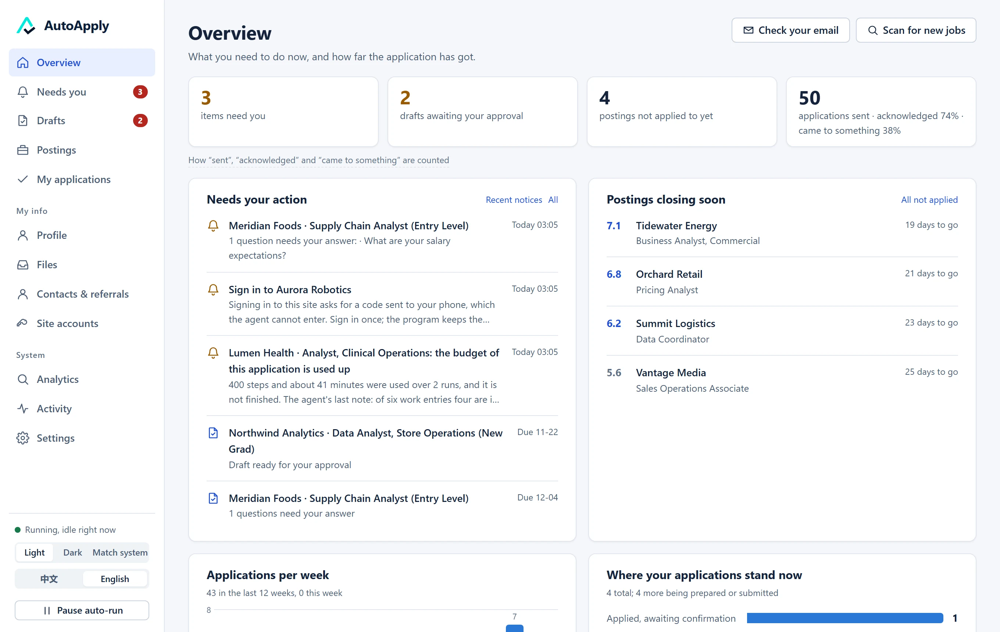
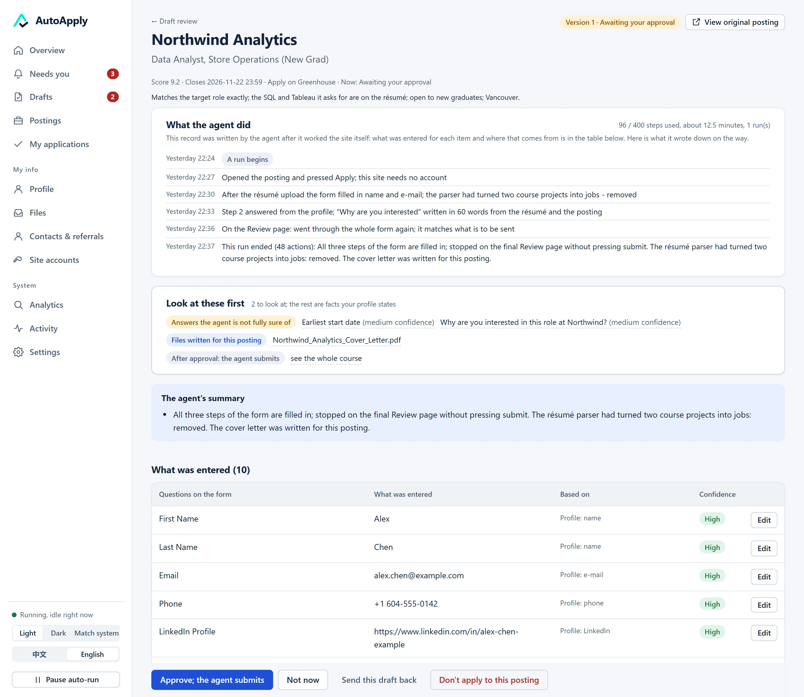
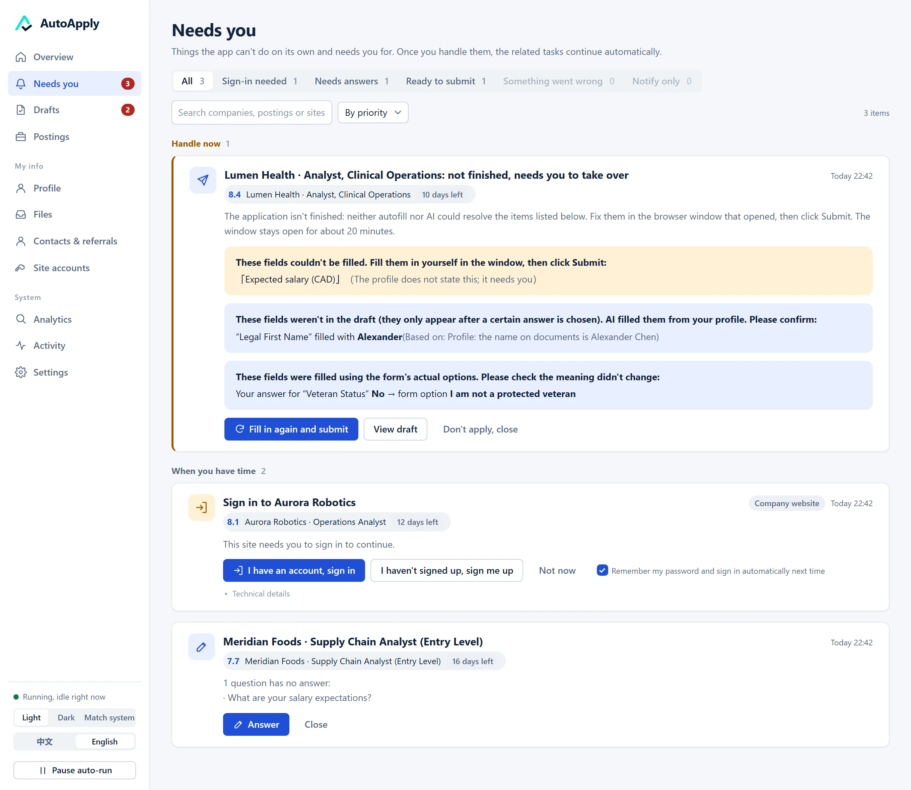
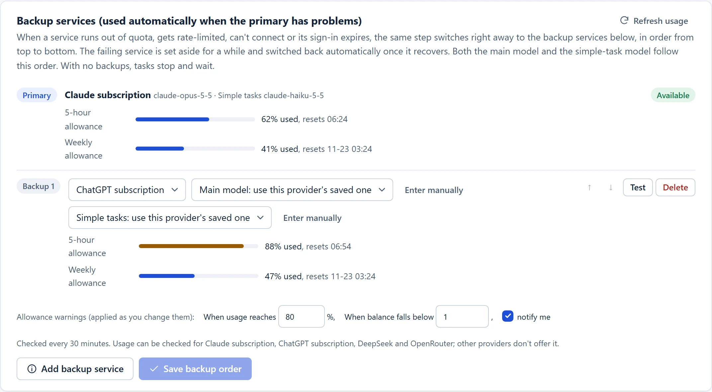
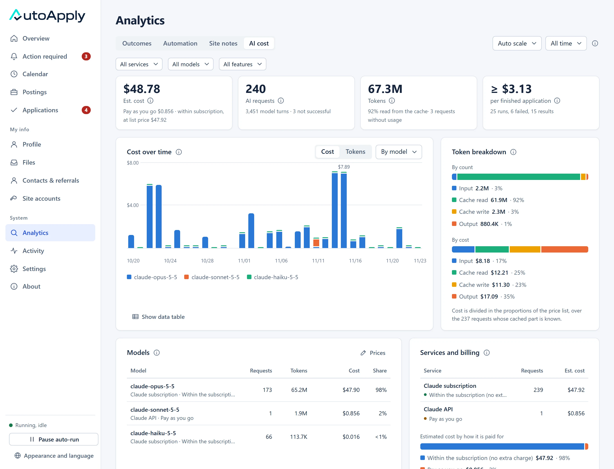
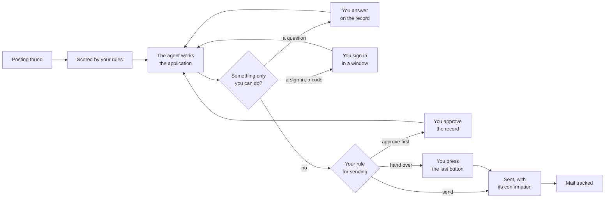

<p align="center">
  
</p>

<p align="center">
  <b>A job-search assistant that runs on your own computer.</b><br>
  It finds postings, scores them against your own rules, and an AI agent works each application<br>
  from the posting to the confirmation - asking <b>you</b> what only you can answer. Then it reads your mail to track what happens.
</p>

<p align="center">
  <a href="https://github.com/Liam-Frost/AutoApply/releases/latest"></a>
  <a href="https://github.com/Liam-Frost/AutoApply/actions/workflows/ci.yml"></a>
  
  <a href="LICENSE"></a>
</p>

<p align="center"><b>English</b> | <a href="README.zh-CN.md">简体中文</a></p>



## Contents

- [What it does](#what-it-does)
- [What it will not do](#what-it-will-not-do)
- [Install](#install)
- [First run](#first-run)
- [On a server](#on-a-server)
- [How an application goes out](#how-an-application-goes-out)
- [AI services, backups and allowance](#ai-services-backups-and-allowance)
- [Your data](#your-data)
- [What earlier versions got wrong, and what changed](#what-earlier-versions-got-wrong-and-what-changed)
- [What has been verified](#what-has-been-verified)
- [Development](#development)
- [Community](#community)
- [License](#license)

## What it does

| | |
|---|---|
| **Finds postings** | Reads the careers pages of the employers you choose (Greenhouse, Lever, Ashby, SmartRecruiters and Workday boards, eight large tech companies, field job boards with a feed, or any careers page read by the AI). 46 employers and 16 job boards are checked and ready to pick from. |
| **Scores them** | Against rules written in plain language that you can edit. Postings that cannot fit (wrong country, wrong level) are dropped before any AI is spent on them. |
| **Applies** | For a posting worth it, one AI agent opens the employer's site and works the application the way a careful person would: it reads the pages, signs in or registers, fills every section from your profile and résumé, uploads the right files, and looks again after every step. What the form needs and you never told the program, it asks you - it does not guess. |
| **Keeps a record** | What was entered for every question and where that comes from. Correct an entry or say what to change in plain words ("say I can start in May"), and the agent goes back and changes it. |
| **Sends it the way you chose** | By itself when nothing is open (the default); only after you have approved the record; or it stops at the last step and gives you the window. Per company if you like. |
| **Tracks the result** | Reads your mailbox (read-only) for confirmations, rejections and interview invitations and updates each application. |

It adapts to who you are: a first-run guide asks your career stage (internship, new graduate, experienced), field and target roles, and sets up filters, scoring rules and the interface accordingly. Not only for software jobs.

<table>
<tr>
<td width="50%"><br><sub><b>The record of an application.</b> Every answer with where it comes from.</sub></td>
<td width="50%"><br><sub><b>Needs you.</b> What the program could not do alone, listed by name.</sub></td>
</tr>
<tr>
<td><br><sub><b>Postings</b>, scored and sorted, with where each application stands.</sub></td>
<td><br><sub><b>Backup AI services</b> with the allowance each one has left.</sub></td>
</tr>
<tr>
<td colspan="2"><br><sub><b>What the AI costs.</b> Every model request is recorded: tokens by kind, cost by model and feature, cost per result, and what failures cost.</sub></td>
</tr>
</table>

## What it will not do

The agent decides how to work a form. Four things are not its to decide:

- **It does not invent anything about you.** Answers, cover letters and tailored résumés come from your résumé, your profile and what you answered. What is missing is asked, and an application with a question open is not sent.
- **Sending follows your rule.** A run is told whether it may send; saving a step or a profile on the way is not sending. An application is recorded as sent only with its confirmation: the page's own words, its address, and what ties it to the posting. If a run is cut off after it said it was about to send, the program looks whether the application is out before anything is pressed again. (This is an instruction the agent is given and reports against - the program does not claim to recognise every *Submit* button on every site.)
- **It does not see your passwords, and does not get round a human check.** A stored password is typed by the program, into the site's own sign-in page and nowhere else; the agent only learns that it was typed. CAPTCHAs, codes on your phone and identity checks are handed to you.
- **An application has a budget** (400 steps and 45 minutes by default). When it is used up the agent stops and asks whether to go on.

## Install## Install

Download from the [latest release](https://github.com/Liam-Frost/AutoApply/releases/latest):

| System | File | How |
|---|---|---|
| **Windows 10 / 11** | `AutoApply-Setup-<version>.exe` | Run it. Choose where to install and which shortcuts you want. |
| **macOS 12+** | `AutoApply-<version>-macos.dmg` | Open it and drag AutoApply to Applications. |
| **Linux** | `AutoApply-<version>-linux.run` | `sh AutoApply-<version>-linux.run` (x86-64 and ARM64; add `--yes` to install without questions, for a server) |
| Any, portable | `AutoApply-<version>.zip` | Unzip, then `start.bat` (Windows) or `./start.sh`. |

<p align="center"></p>

The installer needs no administrator rights and puts everything in your user folder. It brings [uv](https://docs.astral.sh/uv/) with it and uses it to download Python, the dependencies and the program's own browser (about 600 MB, a few minutes; you can cancel, and running it again continues). Running a newer installer upgrades: your data is never touched, AutoApply has to be quit first (the installer says so and waits), and if the new version cannot be made ready the previous one is put back. Running it again when the same version is installed repairs it. Remove it from *Settings → Apps*; you are asked whether your data goes too. Its language follows your system (Chinese or English) and can be switched in the window.

> **The packages are not code-signed.** Windows shows *Windows protected your PC*: choose *More info → Run anyway*. On macOS, right-click the app the first time and choose *Open*. Every package is built by [the release workflow](.github/workflows/release.yml), installed and started on its own system before it is published, and listed with its SHA-256 in `SHA256SUMS.txt`.

Cover letters, résumé tailoring and Word previews need a Word-to-PDF converter: Microsoft Word if you have it, otherwise the free [LibreOffice](https://www.libreoffice.org/).

## First run

An icon appears in the tray (menu bar on macOS) and the page opens at `http://127.0.0.1:8000`. The first time, it asks you to choose the administrator's name and password; from then on it asks for them, on this computer too. Forgotten: the tray menu's *Reset the administrator password*.

<p align="center"></p>

1. **The guide** asks who you are and what you are looking for, then proposes filters and scoring rules you can edit.
2. **AI service**: sign in with a Claude or ChatGPT subscription, or paste an API key (see below).
3. **Profile**: upload your résumé; the program drafts your profile from it and marks what forms will ask that the résumé does not say.
4. **How applications are sent**: by itself, after your approval, or by you (*Settings → Automation → How it is sent*). To watch first, choose approval.
5. **Try one**: paste a posting's address and watch the agent work it.

After that it works on a schedule: scan, score, apply, and tell you when something needs you (in the page, and on Telegram if you set it up).

## On a server

AutoApply is an agent that is meant to keep running, so it can live on a Linux server, a NAS or any computer without a screen, and be used from the browser of another computer or a phone.

**With Docker** (the image brings the browser, its system libraries, a virtual screen, LibreOffice and Chinese fonts):

```bash
curl -O https://raw.githubusercontent.com/Liam-Frost/AutoApply/master/docker-compose.yml
docker compose up -d
docker compose exec autoapply autoapply set-admin     # choose the administrator's name and password
```

Then open `http://127.0.0.1:8000` on that computer. Everything that is yours is in the volume `autoapply-data`.

**Without Docker**: `sh AutoApply-<version>-linux.run --yes --service` installs for the current user and registers a systemd user service (started with the computer, restarted when it fails). `autoapply doctor --deep` then lists what the computer lacks - the browser's libraries, a virtual screen, LibreOffice, fonts - each with the command that adds it; the same list is under *Settings → System and data → Diagnostics*.

What is different on a server:

- **Windows that need you open in the web page.** Signing in to a site, pressing *Submit* yourself: on a desktop these open a browser window. Without a screen the page is shown in AutoApply's own page - a notice at the top, and a Telegram message with a link if you set that up - and you click and type there. A site that refuses a hidden browser gets a real window on a virtual screen, which is shown the same way.
- **Use HTTPS from other devices.** The server speaks plain HTTP. For access from anywhere but the computer itself, put a reverse proxy that does HTTPS in front and turn on *a reverse proxy does the HTTPS* under *Settings → System and data → Remote access*. Until then the remote window is refused to other devices, because passwords are typed into it.
- **Passwords and keys are in an encrypted file**, `data/secrets.bin`, because a server has no keyring. By default its master key is beside it; to keep the key elsewhere set `AUTOAPPLY_MASTER_KEY_FILE` (a Docker secret, a systemd credential). Keep a copy of that key: without it the saved passwords are lost.
- **A sign-in that cannot be done on a server can be carried over.** Passkeys, and sites that only accept a computer they know: sign in with AutoApply on your own computer, export the sign-in under *Site accounts* (encrypted with a passphrase), import it on the server.

## How an application goes out



What is worth knowing about it:

- **One agent, the whole task.** It is given everything at once - the posting, your profile and résumé, your files, what earlier runs on this application did, what is written down about the site - and one set of tools: look at the page, list its controls, click, type, choose, upload, run a script. Nothing prepares the form for it and nothing checks its clicks; it looks before it acts and again after.
- **The program keeps what must not depend on a model's memory.** Where the application stands, its record, its journal and its budget are in the database and on disk: a run that is cut off - the window closed, the computer restarted - is taken up from there, in a new window if need be.
- **Three different ways of stopping, three different answers.** The AI service's allowance has run out: the task waits and is tried again when it is back. The application's own budget is used up: you are asked whether to give it another. It ended at the same place three times: it is brought to you with what it wrote down.
- **What it learns is words.** After working a site the agent writes down what the next application there should know - how a control behaves, what the résumé parser gets wrong - and reads it the next time. Notes about recruiting systems (Workday, Greenhouse, Ashby, SmartRecruiters, SuccessFactors and others) ship with the program. *Analysis → Site notes* shows what it wrote, and lets you clear it.
- **How forms are filled is in a manual you can edit** (*Settings → System and data → Expert tools → Prompts*): fill optional sections, decline job alerts, what to do with consent notices. A rule about you alone belongs in your profile.

## AI services, backups and allowance

*Settings → Accounts and connections → AI service.*

| Service | How you pay | Allowance can be read |
|---|---|---|
| Claude subscription (Pro / Max) | your subscription | yes |
| ChatGPT subscription (Plus / Pro) | your subscription | yes |
| Claude API | per use | no (Anthropic offers no call for it) |
| OpenAI API | per use | no |
| Google Gemini | per use | no |
| DeepSeek | per use | yes (balance) |
| Qwen (DashScope) | per use | no |
| OpenRouter | per use | yes (credits) |
| Any OpenAI-compatible endpoint, including a local Ollama | — | no |

**Backups.** List backup services in order. When the one in use runs out, is rate-limited or cannot be reached, the same step is repeated on the next one; the service that failed rests until its window resets, then is used again. This holds for the main model and for the small model used for simple tasks.

**Allowance.** Where a service reports it, the program shows how much is used, warns you once when it passes the level you set (80 % by default), and stops calling a service that is used up until it resets.

The Claude subscription is the best-tested service, and the agent was built and measured with Anthropic's most capable model. Others work through the same interface; a weaker model works a form less reliably, and a whole application is many model calls - on real sites a run has used several million cached tokens. *Analysis → AI cost* shows what each application took.

## Your data

- Everything is on your computer: a SQLite database, your files, and a few Markdown documents you can read and edit (your profile, the scoring rules, notes about sites).
- Passwords and API keys are in the system keyring - on a server, which has none, in an encrypted file. Saved sign-ins are encrypted.
- Nothing is sent anywhere except to the AI service you chose and to the job sites themselves. There is no telemetry and no account.
- The page asks for a login - one account, whose name and password you choose the first time you open it on the computer it runs on. Only a salted hash of the password is kept.
- The server listens on `127.0.0.1` unless you change that under Settings → System and data → Remote access, and answers only its own pages: requests from other websites open in your browser are refused. It does not do HTTPS itself; for access from outside your own network, put a reverse proxy that does in front of it.
- *Settings → System and data → Backup and updates → Export all data* writes one zip; `uv run autoapply restore <file.zip>` brings it back on another computer.

## What earlier versions got wrong, and what changed

There have been three attempts, and the first two failed in the same direction.

**The first** (the `legacy-v0` branch) had about 55,000 lines of code and 1,720 passing tests, and could not submit an application. The model filled a few constrained text slots inside a fixed pipeline, saw a summary of the page instead of the page, and the applicant was stored as tables and regular expressions. In the same months its author sent more than 140 real applications by driving a general coding agent by hand.

**1.0** gave the model the page and kept a pipeline around it: read the form into a structure, draft answers, fill by a coded driver per recruiting system, compare every value, let an AI "take over" a page that would not fill, gate what it could press, learn recipes and plugins from runs, replay saved pages as a self-check. It sent real applications. It also grew to about 31,000 lines and 86 regular expressions, with the model called through seven narrow openings, and every site that behaved a little differently became another rule, another gate and another test pinned to a fixture: an application made in four stages was reported as done after the first, a confirmation that showed no expected phrase was not recognised, a broken driver was retried instead of handed to the agent that could have done the work.

**2.0** takes the lesson the author's own hand-driven applications had been showing all along: a capable model with the whole context and ordinary browser tools works an application; software built around it to make it "safe" mostly keeps it from doing so.

| What 1.x did | What 2.0 does |
|---|---|
| A pipeline of stages, each with its own narrow prompt and its own tools | One agent, one run, from the posting to the confirmation |
| A driver per recruiting system, an explorer for the rest, a repair agent, a gate | One set of browser tools for every site; what is known about a system is notes the agent reads |
| The form read into a structure first, answers drafted against it, values compared afterwards | The agent fills the real form and reports what it entered and why |
| Rules in code for what a button is, what a confirmation looks like, when a step is the last | The agent judges the page; the program holds four limits and the state |
| What was learned kept as recipes, plugins and saved pages, checked by more code | What was learned kept as sentences |
| Tests pinned to saved pages of real sites | Evaluation forms with an employer's side: a run is judged by what the employer received (`eval/`) |

The drivers, the fallback chain, the repair agent, the gate, the learned plugins and the self-check were removed, not kept as a fallback: more than 15,000 lines of code and tests.

## What has been verified

Honest status, kept in [docs/STATUS.md](docs/STATUS.md). In short:

| | Status |
|---|---|
| Windows 10 / 11 | used daily |
| The application agent on the project's evaluation forms (a profile-first wizard, a form in another site's frame, a site that needs an account; a run killed half-way and taken up again) | every check passed, judged by what the employer's side received |
| The application agent on real sites | three real postings worked up to the last step without sending (a SAP SuccessFactors site, a Workday site, Google Careers): accounts made, every step filled, questions asked. **No real application has been sent by the 2.0 agent yet** |
| Sending by itself, after approval, or handing the window over | through the queue on the evaluation form; not on a real site |
| Applications sent with 1.x (Greenhouse, Microsoft Careers, BambooHR and JazzHR sites) | real, confirmed by mail; that code is gone |
| A co-op portal read by the agent | on the evaluation site's portal (a sign-in, a list on two pages): signed in, listed everything, stored every posting. Not on a real portal |
| UBC portal | postings imported for real; the agent scanning the portal and applying through it are not confirmed on the real portal |
| The login, the listening address and the path prefix | login run end to end on a scratch copy; access from another device or behind a real reverse proxy not run |
| Windows installer (install, upgrade, refusing to run over a running copy, cancel with the previous version put back, uninstall) | run end to end into a scratch folder, by CI on every release |
| Failover between AI services | run once for real, when a subscription had actually run out |
| macOS and Linux packages | built, installed and started by CI on every release; not used day to day by the author |
| Other AI services than the Claude subscription | interface tested; application quality not compared |
| English interface | machine-translated, not proof-read |

## Development

```bash
git clone https://github.com/Liam-Frost/AutoApply
cd AutoApply
./start.sh            # or start.bat: installs what is missing, builds the interface, starts
```

| Command | What it does |
|---|---|
| `uv run pytest` | the tests (they never reach a real AI service or a real website) |
| `uv run autoapply serve` | the server only, in the terminal |
| `uv run autoapply tray` | the tray launcher |
| `uv run autoapply reset-admin` | forget the administrator's password; the next visit from this computer sets a new one |
| `uv sync --extra nodriver` | install the optional second browser backend |
| `cd frontend && npm run dev` | the interface with hot reload |
| `uv run python scripts/demo.py --serve 8020` | a demo copy with made-up data (what the screenshots show) |
| `uv run python scripts/make_release.py` | the portable zip |
| `uv run python scripts/make_installer.py` | the Windows installer |

Layout: `backend/autoapply` (FastAPI, SQLite, Playwright; `agent/` is the application agent - `apply.md` its manual, `hands.py` its browser tools, `run.py` one run, `work.py` what a run's outcome becomes, `playbooks/` the notes about recruiting systems; `llm.py` the services and their failover, `access.py` the login and where the server listens), `eval` (forms with an employer's side, and the harness that runs the agent on them: `python eval/run.py --all`, or one shape with `--form profile_first` - it spends your AI allowance), `frontend` (Vue 3), `scripts` (packaging, setup, demo), `docs`.

**Releasing.** Set the version in `pyproject.toml`, add the section to `CHANGELOG.md`, then:

```bash
git tag v1.2.3 && git push origin v1.2.3
```

The release workflow runs the tests, builds the four packages, installs and starts each one on Windows, macOS and Linux, and only then publishes the release.

Contributions that add one entry to a list (an employer, a job board, a sign-in provider, a mailbox, a region pack, a translation) need no knowledge of the whole program: see [CONTRIBUTING.md](CONTRIBUTING.md). The interface follows [docs/DESIGN_SYSTEM.md](docs/DESIGN_SYSTEM.md).

## Community

- Something does not work, or you have an idea: [open an issue](https://github.com/Liam-Frost/AutoApply/issues/new/choose).
- A security problem: privately, as described in [SECURITY.md](SECURITY.md).
- How to take part: [CONTRIBUTING.md](CONTRIBUTING.md) and the [Code of Conduct](CODE_OF_CONDUCT.md).
- What changed in each version: [CHANGELOG.md](CHANGELOG.md).

## License

[PolyForm Noncommercial 1.0.0](LICENSE): free for personal and other noncommercial use.

The interface includes [noVNC](https://github.com/novnc/noVNC) (MPL 2.0), unmodified, for showing a virtual screen; its source is at that address.

You are responsible for following the terms of use of the job sites you apply through. The program fills in your own applications with your own information; it is not a tool for applying on behalf of others or in bulk.
