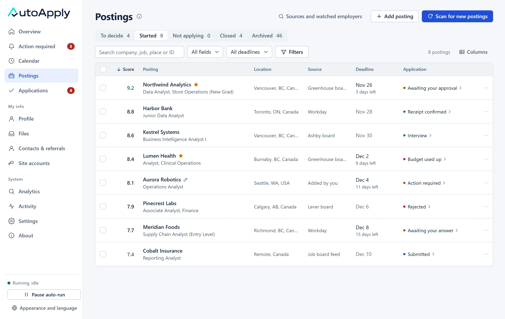
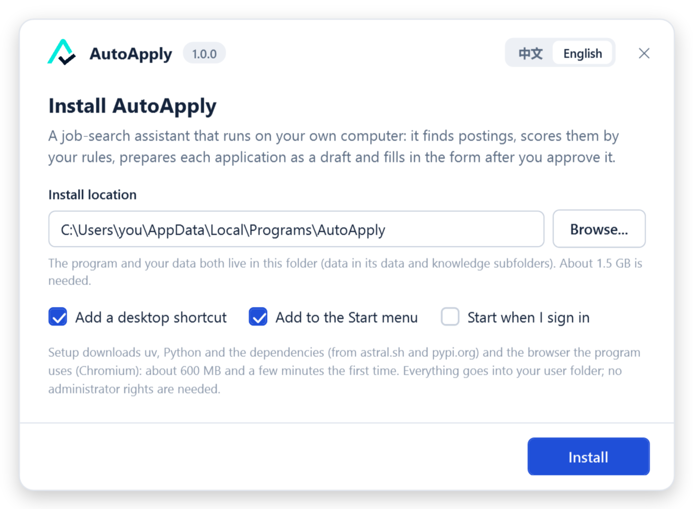
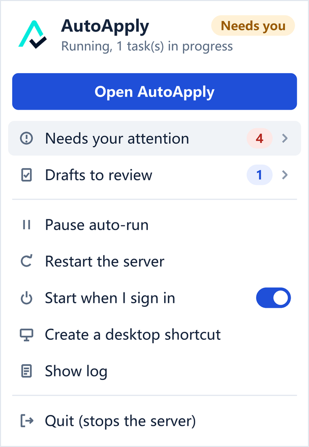
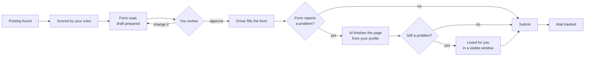

<p align="center">
  
</p>

<p align="center">
  <b>A job-search assistant that runs on your own computer.</b><br>
  It finds postings, scores them against your own rules, prepares every application as a draft,<br>
  and fills in the form after <b>you</b> approve it. Then it reads your mail to track what happens.
</p>

<p align="center">
  <a href="https://github.com/Liam-Frost/AutoApply/releases/latest"></a>
  <a href="https://github.com/Liam-Frost/AutoApply/actions/workflows/ci.yml"></a>
  
  <a href="LICENSE"></a>
</p>

<p align="center"><b>English</b> | <a href="README.zh-CN.md">简体中文</a></p>


## Contents

- [What it does](#what-it-does)
- [What it will not do](#what-it-will-not-do)
- [Install](#install)
- [First run](#first-run)
- [How an application goes out](#how-an-application-goes-out)
- [AI services, backups and allowance](#ai-services-backups-and-allowance)
- [Your data](#your-data)
- [What the previous version got wrong, and what changed](#what-the-previous-version-got-wrong-and-what-changed)
- [What has been verified](#what-has-been-verified)
- [Development](#development)
- [License](#license)

## What it does

| | |
|---|---|
| **Finds postings** | Reads the careers pages of the employers you choose (Greenhouse, Lever, Ashby, SmartRecruiters and Workday boards, eight large tech companies, field job boards with a feed, or any careers page read by the AI). 46 employers and 16 job boards are checked and ready to pick from. |
| **Scores them** | Against rules written in plain language that you can edit. Postings that cannot fit (wrong country, wrong level) are dropped before any AI is spent on them. |
| **Drafts the application** | Opens the real form, reads every question, and answers from your profile only. Each answer shows where it came from and how sure it is. Questions it cannot answer are left for you, not guessed. |
| **Waits for you** | You review the draft, change anything in plain words ("make the second paragraph about my internship"), and approve. |
| **Fills in the form** | A driver fills the form, the program checks what the form itself reports, and an AI takes over whatever is left. You press *Submit* yourself unless you have chosen otherwise. |
| **Tracks the result** | Reads your mailbox (read-only) for confirmations, rejections and interview invitations and updates each application. |

It adapts to who you are: a first-run guide asks your career stage (internship, new graduate, experienced), field and target roles, and sets up filters, scoring rules and the interface accordingly. Not only for software jobs.

<table>
<tr>
<td width="50%"><br><sub><b>A draft.</b> Every answer with its source; nothing is sent before you approve.</sub></td>
<td width="50%"><br><sub><b>Needs you.</b> What the program could not do alone, listed by name.</sub></td>
</tr>
<tr>
<td><br><sub><b>Postings</b>, scored and sorted, with where each application stands.</sub></td>
<td><br><sub><b>Backup AI services</b> with the allowance each one has left.</sub></td>
</tr>
</table>

## What it will not do

These are fixed in code and have no switch:

- **It does not invent anything about you.** Answers, cover letters and tailored résumés use only your résumé and the profile you confirmed.
- **It does not submit what you have not approved.** The tools the AI is given cannot press Submit.
- **It does not get around a site's protections.** No CAPTCHA solving, no disguised browser. A site that refuses the program's browser is handed to you.
- **It does not call a form filled in while the form says otherwise.** If a field is still empty or rejected, you are told which one.
- **It does not see your passwords.** They are in the system keyring; the AI only learns "signed in" or "needs you".

## Install

Download from the [latest release](https://github.com/Liam-Frost/AutoApply/releases/latest):

| System | File | How |
|---|---|---|
| **Windows 10 / 11** | `AutoApply-Setup-<version>.exe` | Run it. Choose where to install and which shortcuts you want. |
| **macOS 12+** | `AutoApply-<version>-macos.dmg` | Open it and drag AutoApply to Applications. |
| **Linux** | `AutoApply-<version>-linux.run` | `sh AutoApply-<version>-linux.run` |
| Any, portable | `AutoApply-<version>.zip` | Unzip, then `start.bat` (Windows) or `./start.sh`. |

<p align="center"></p>

The installer needs no administrator rights and puts everything in your user folder. The first run downloads [uv](https://docs.astral.sh/uv/), Python, the dependencies and the program's own browser (about 600 MB, a few minutes). The same installer upgrades, repairs and removes the program; an upgrade never touches your data. Its language follows your system (Chinese or English) and can be switched in the window.

> **The packages are not code-signed.** Windows shows *Windows protected your PC*: choose *More info → Run anyway*. On macOS, right-click the app the first time and choose *Open*. Every package is built by [the release workflow](.github/workflows/release.yml), installed and started on its own system before it is published, and listed with its SHA-256 in `SHA256SUMS.txt`.

Cover letters, résumé tailoring and Word previews need a Word-to-PDF converter: Microsoft Word if you have it, otherwise the free [LibreOffice](https://www.libreoffice.org/).

## First run

An icon appears in the tray (menu bar on macOS) and the page opens at `http://127.0.0.1:8000`.

<p align="center"></p>

1. **The guide** asks who you are and what you are looking for, then proposes filters and scoring rules you can edit.
2. **AI service**: sign in with a Claude or ChatGPT subscription, or paste an API key (see below).
3. **Profile**: upload your résumé; the program drafts your profile from it and marks what forms will ask that the résumé does not say.
4. **Try one**: paste a posting's address and watch a draft being prepared, without sending anything.

After that it works on a schedule: scan, score, draft, and tell you when something needs you (in the page, and on Telegram if you set it up).

## How an application goes out



Three things about this chain are worth knowing:

- **The form has the last word.** After filling, the program asks the page itself what is wrong: fields it marks invalid, its error messages, required fields still empty. Neither the driver nor the AI can declare a page done while the page disagrees.
- **The AI is the fallback, not the pilot.** Deterministic drivers do the routine work quickly and for free. The AI steps in for a form nobody has seen before, a field that appeared after an answer, or a value the form rejects, and it may only use what your profile states.
- **What it learns stays.** Notes about a site, the form's own wording for your answers and the fields it discovered are kept, so the next run needs less help.

Who presses *Submit* is your choice per site: by default an approved draft on a well-proven site is submitted for you, and anything the AI had to touch, any site without a dedicated driver, and any answer you were unsure about waits for your click.

## AI services, backups and allowance

*Settings → AI model.*

| Service | How you pay | Allowance can be read |
|---|---|---|
| Claude subscription (Pro / Max) | your subscription | yes |
| ChatGPT subscription (Plus / Pro) | your subscription | yes |
| Claude API | per use | no (Anthropic offers no call for it) |
| OpenAI API | per use | no |
| Google Gemini | per use | no |
| DeepSeek | per use | yes (balance) |
| Qwen (DashScope) | per use | no |
| OpenRouter | per use | yes (credits) |
| Any OpenAI-compatible endpoint, including a local Ollama | — | no |

**Backups.** List backup services in order. When the one in use runs out, is rate-limited or cannot be reached, the same step is repeated on the next one; the service that failed rests until its window resets, then is used again. This holds for the main model and for the small model used for simple tasks.

**Allowance.** Where a service reports it, the program shows how much is used, warns you once when it passes the level you set (80 % by default), and stops calling a service that is used up until it resets.

The Claude subscription is the best-tested service. Others work through the same interface; weaker models read forms less reliably. All the guard rails above are in code and do not depend on the model.

## Your data

- Everything is on your computer: a SQLite database, your files, and a few Markdown documents you can read and edit (your profile, the scoring rules, notes about sites).
- Passwords and API keys are in the system keyring. Saved sign-ins are encrypted.
- Nothing is sent anywhere except to the AI service you chose and to the job sites themselves. There is no telemetry and no account.
- The server listens on `127.0.0.1` only.
- *Settings → Advanced → Export all data* writes one zip; `uv run autoapply restore <file.zip>` brings it back on another computer.

## What the previous version got wrong, and what changed

AutoApply 1.0 is a rewrite. The earlier version (the `legacy-v0` branch) had about 55,000 lines of code and 1,720 passing tests, and could not submit an application: form filling, submission, status tracking and scheduled search all ended in `not_implemented`. In the same months, the same author sent more than 140 real applications by driving a general coding agent by hand. Comparing the two showed what was wrong.

| What the previous version did | Why it failed | What 1.0 does |
|---|---|---|
| **Measured progress in tests.** 1,720 tests, none of which sent an application. | Tests passed while the product did not work. | Every milestone is accepted on real applications. [docs/STATUS.md](docs/STATUS.md) says what has been run for real and what has only been unit-tested. |
| **Put the AI in boxes.** The model filled a few constrained text slots inside a fixed pipeline. | Real forms are irregular; a pipeline has no slot for "this field appeared after I answered that one". | The model perceives, judges and repairs; code keeps state, executes and enforces the rules. |
| **Showed the model a summary of the page.** A static snapshot of at most 60 fields, no screenshot. | The model could not see what a person sees, so it could not notice an error message or a custom control. | The AI reads the whole page, takes screenshots, lists controls and their options, and asks the form what it still complains about. |
| **Stored the applicant as tables and regular expressions.** A structured schema plus ten categories of pattern-matched answers. | Real rules have conditions and exceptions ("use my legal name only when the form asks for it") that a table cannot hold. | The profile is a dated Markdown document that you and the AI both read and correct. |
| **Wrote cover letters from keyword buckets.** Classify the posting, pick a hard-coded skill bucket, fill five fixed paragraphs. | Letters that could be about anyone. | The letter is written from your whole résumé, the whole posting and your own example letters, then checked against your résumé for anything invented. |
| **One adapter per job site, written in advance.** | Never caught up: most sites had none. | Dedicated drivers for the common systems; any other site is explored by the AI once, and what it learns is kept. |
| **No fallback.** A step either worked or stopped. | One unexpected field ended the run. | Driver → the form's own verdict → AI take-over → verdict again → you. A run is handed over, not thrown away. |

Two mistakes were made again while building 1.0 and are fixed in this release, recorded here because they are easy to repeat:

- The AI take-over was first allowed to set only a given list of fields. It ignored a required field that appeared after an answer and reported a form as filled while the form showed errors. *Now it finishes the page, and the page decides.*
- A form described with selectors like "the second drop-down on the page" gave several questions the same identity, and their answers were lost. *Now every question has its own identity however the form is described, and positional selectors are refused.*

## What has been verified

Honest status, kept in [docs/STATUS.md](docs/STATUS.md). In short:

| | Status |
|---|---|
| Windows 10 / 11 | used daily |
| Greenhouse; forms explored by the AI (Microsoft Careers, BambooHR, JazzHR sites) | real applications submitted and confirmed by mail |
| Ashby | filled and read back on real forms; none submitted yet |
| Workday, the UBC portal driver | written from earlier manual runs; the steps after sign-in have not been run for real |
| Windows installer (install, upgrade over a running copy, repair, uninstall) | run end to end |
| Failover between AI services | run once for real, when a subscription had actually run out |
| macOS and Linux packages | built, installed and started by CI on every release; not used day to day by the author |
| Other AI services than the Claude subscription | interface tested; application quality not compared |
| English interface | machine-translated, not proof-read |

## Development

```bash
git clone https://github.com/Liam-Frost/AutoApply
cd AutoApply
./start.sh            # or start.bat: installs what is missing, builds the interface, starts
```

| Command | What it does |
|---|---|
| `uv run pytest` | the tests (they never reach a real AI service or a real website) |
| `uv run autoapply serve` | the server only, in the terminal |
| `uv run autoapply tray` | the tray launcher |
| `cd frontend && npm run dev` | the interface with hot reload |
| `uv run python scripts/demo.py --serve 8020` | a demo copy with made-up data (what the screenshots show) |
| `uv run python scripts/make_release.py` | the portable zip |
| `uv run python scripts/make_installer.py` | the Windows installer |

Layout: `backend/autoapply` (FastAPI, SQLite, Playwright; `ats/` holds the drivers and the page audit, `executor.py` the fallback chain, `repair.py` the AI take-over, `llm.py` the services and their failover), `frontend` (Vue 3), `scripts` (packaging, setup, demo), `docs`.

**Releasing.** Set the version in `pyproject.toml`, add the section to `CHANGELOG.md`, then:

```bash
git tag v1.2.3 && git push origin v1.2.3
```

The release workflow runs the tests, builds the four packages, installs and starts each one on Windows, macOS and Linux, and only then publishes the release.

Contributions that add one entry to a list (an employer, a job board, a sign-in provider, a mailbox, a region pack, a translation) need no knowledge of the whole program: see [CONTRIBUTING.md](CONTRIBUTING.md). The interface follows [docs/DESIGN_SYSTEM.md](docs/DESIGN_SYSTEM.md).

## License

[PolyForm Noncommercial 1.0.0](LICENSE): free for personal and other noncommercial use.

You are responsible for following the terms of use of the job sites you apply through. The program fills in your own applications with your own information; it is not a tool for applying on behalf of others or in bulk.
