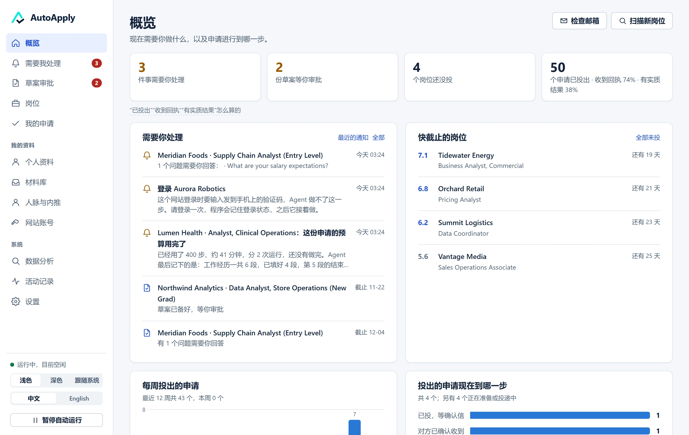
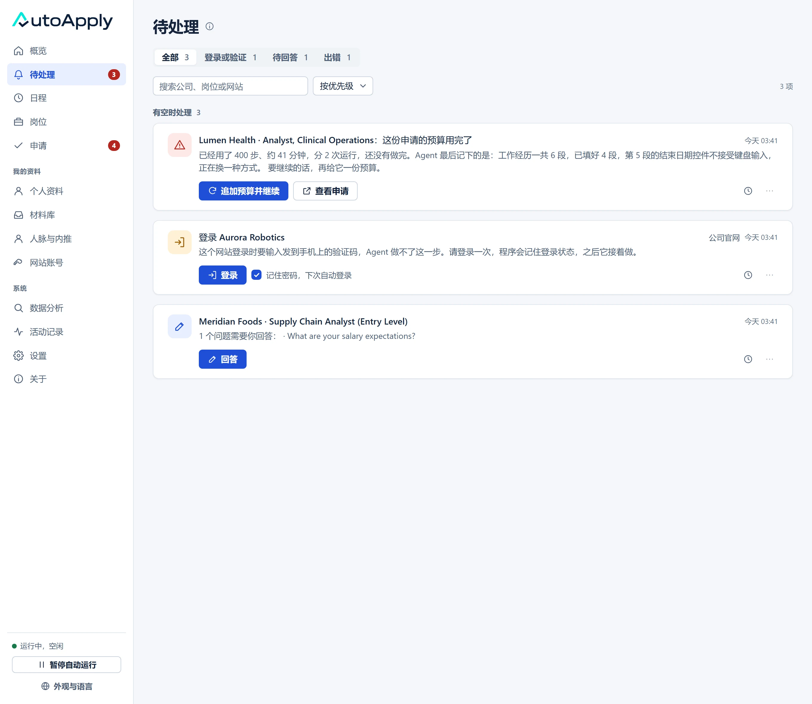
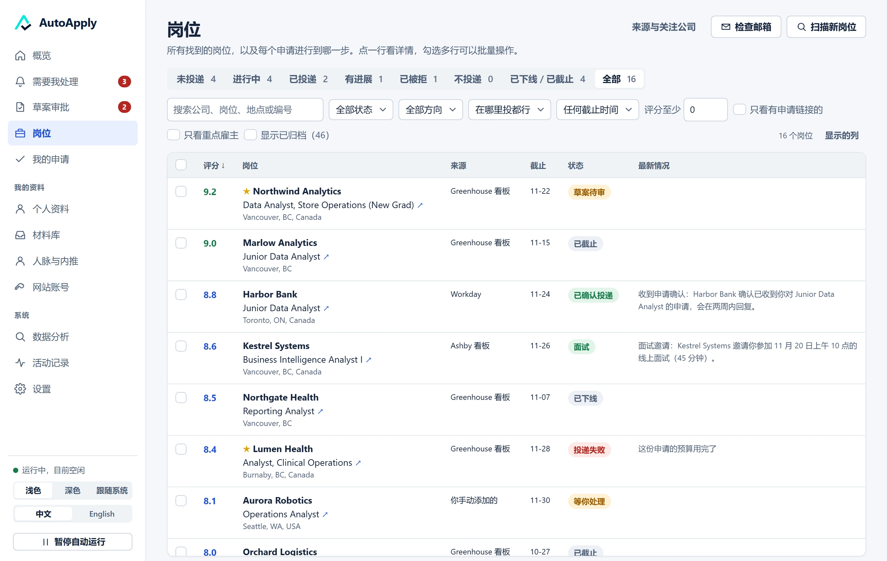
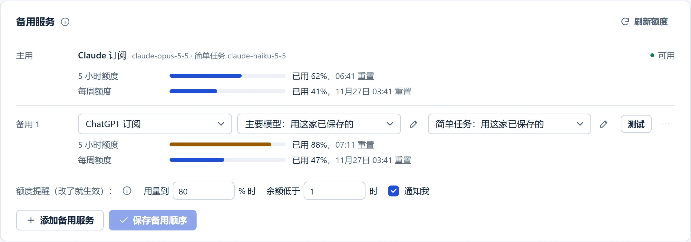
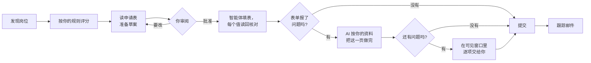

<p align="center">
  
</p>

<p align="center">
  <b>在你自己电脑上运行的求职助手。</b><br>
  找岗位、按你自己的规则评分、把每份申请准备成草案，<br>
  <b>你批准之后</b>才替你填表。之后读邮件，跟踪每份申请的进展。
</p>

<p align="center">
  <a href="https://github.com/Liam-Frost/AutoApply/releases/latest"></a>
  <a href="https://github.com/Liam-Frost/AutoApply/actions/workflows/ci.yml"></a>
  
  <a href="LICENSE"></a>
</p>

<p align="center"><a href="README.md">English</a> | <b>简体中文</b></p>



## 目录

- [它做什么](#它做什么)
- [它不做什么](#它不做什么)
- [安装](#安装)
- [第一次使用](#第一次使用)
- [一份申请是怎么投出去的](#一份申请是怎么投出去的)
- [AI 服务、备用和额度](#ai-服务备用和额度)
- [你的数据](#你的数据)
- [上一版错在哪里，这一版改了什么](#上一版错在哪里这一版改了什么)
- [哪些实际验证过](#哪些实际验证过)
- [开发](#开发)
- [社区](#社区)
- [许可](#许可)

## 它做什么

| | |
|---|---|
| **找岗位** | 读你选的雇主的招聘页：Greenhouse、Lever、Ashby、SmartRecruiters、Workday 的公开看板，八家大型科技公司的官网，有订阅源的行业职位站，或者任意招聘页（由 AI 读）。有 46 家雇主和 16 个职位站已经核对过，可以直接勾选。 |
| **评分** | 按你用大白话写的规则评分，规则可以随时改。明显不合适的岗位（国家不对、级别不对）在花 AI 额度之前就被筛掉。 |
| **准备草案** | 打开真实的申请表，读出每一道题，只用你的个人资料作答。每个答案都写明依据和把握；答不上来的留给你，不猜。 |
| **等你** | 你审阅草案，用平常说话的方式改（“求职信第二段改成讲我的实习”），然后批准。 |
| **填表** | AI 智能体逐页读真实的表单，按你批准的草案填写；程序把每个值读回来核对，再问表单自己还有什么问题。之后批准过的草案由程序提交，除非你把最后一下留给自己。 |
| **跟踪结果** | 只读你的邮箱，识别确认信、拒信和面试邀请，更新每份申请的状态。 |

它会按你的情况调整：第一次运行时的向导会问你的求职阶段（实习、应届、有经验）、领域和目标岗位，据此设置筛选条件、评分规则和界面。不只是给软件岗位用的。

<table>
<tr>
<td width="50%"><br><sub><b>草案。</b>每个答案都带依据；你批准之前什么都不会发出去。</sub></td>
<td width="50%"><br><sub><b>需要你处理。</b>程序自己做不了的事，逐项列出来。</sub></td>
</tr>
<tr>
<td><br><sub><b>岗位</b>，评分排序，每份申请到了哪一步一目了然。</sub></td>
<td><br><sub><b>备用 AI 服务</b>，以及每家还剩多少额度。</sub></td>
</tr>
<tr>
<td colspan="2"><br><sub><b>AI 花了多少。</b>每次模型请求都有记录：各类 Token、按模型和功能的成本、每个成果的成本、失败花掉的钱。</sub></td>
</tr>
</table>

## 它不做什么

这几条写死在代码里，没有开关：

- **不编造你的任何信息。** 答案、求职信、按岗位调整的简历，只用你的简历和你确认过的个人资料。
- **不提交你没批准的东西。** 交给 AI 的工具里没有“提交”这个动作。
- **不破解人机验证，不替你输入验证码。** 这些步骤，以及拒绝程序浏览器的网站，都交给你。程序还带一个登录页面不太会拒绝的备用浏览器后端，可以在“设置 → 网络”里按网站打开，默认关闭。
- **表单还在报错时，不会说“填好了”。** 哪一栏还空着或被拒绝，会明确告诉你。
- **看不到你的密码。** 密码在系统的密码库里；AI 只知道“已登录”或“需要你来”。

## 安装

从[最新版本](https://github.com/Liam-Frost/AutoApply/releases/latest)下载：

| 系统 | 文件 | 怎么装 |
|---|---|---|
| **Windows 10 / 11** | `AutoApply-Setup-<版本>.exe` | 运行它，选安装位置和要不要快捷方式。 |
| **macOS 12+** | `AutoApply-<版本>-macos.dmg` | 打开后把 AutoApply 拖进“应用程序”。 |
| **Linux** | `AutoApply-<版本>-linux.run` | `sh AutoApply-<版本>-linux.run`（x86-64 和 ARM64；加 `--yes` 可以不提问直接安装，适合服务器） |
| 任意系统，免安装 | `AutoApply-<版本>.zip` | 解压后运行 `start.bat`（Windows）或 `./start.sh`。 |

<p align="center"></p>

安装不需要管理员权限，所有东西都在你的用户目录里。安装程序自带 [uv](https://docs.astral.sh/uv/)，用它下载 Python、依赖和程序自己用的浏览器（约 600 MB，几分钟；可以取消，重新运行会接着来）。运行新版本的安装程序就是升级：不会动你的数据；需要先退出 AutoApply（安装程序会提示并等你）；新版本没能准备好时，会恢复成之前的版本。已经装了同一个版本时再运行一次就是修复。卸载在“设置 → 应用”里，会问你是否连数据一起删除。安装程序的语言跟随系统（中文或英文），也可以在窗口里切换。

> **安装包没有代码签名。** Windows 会提示“Windows 已保护你的电脑”，点“更多信息 → 仍要运行”。macOS 第一次打开时右键点应用，选“打开”。每个安装包都由[发布流程](.github/workflows/release.yml)构建，并在对应系统上实际安装、启动过才会发布；SHA-256 校验值在 `SHA256SUMS.txt` 里。

求职信、按岗位调整简历和 Word 文件预览需要把 Word 转成 PDF：有 Microsoft Word 就用它，没有的话装免费的 [LibreOffice](https://www.libreoffice.org/)。

## 第一次使用

启动后托盘（macOS 是菜单栏）里会出现图标，网页自动打开在 `http://127.0.0.1:8000`。第一次打开时，页面让你设置管理员的用户名和密码；之后每次都要登录，本机访问也一样。忘了密码：托盘菜单里的“重置管理员密码”。

<p align="center"></p>

1. **向导**问你是谁、想找什么，然后给出筛选条件和评分规则的建议，你可以改。
2. **AI 服务**：用 Claude 或 ChatGPT 订阅登录，或者填 API key（见下文）。
3. **个人资料**：上传简历，程序据此起草你的个人资料，并标出申请表会问、但简历上没写的内容。
4. **试一次**：贴一个岗位的网址，看程序怎么准备草案，不会真的发出去。

之后它按计划工作：扫描、评分、准备草案，有事需要你时通知你（在网页里；设置了 Telegram 的话也发到 Telegram）。

## 一份申请是怎么投出去的



这条链路有三点值得知道：

- **表单说了算。** 填完之后，程序会问页面自己哪里不对：被标成无效的字段、页面上的报错、还空着的必填项。只要页面不认，填表程序和 AI 谁都不能说这一页填完了。
- **智能体读表单，规则由代码把住。** 每个网站的表单都由 AI 智能体逐页阅读和填写，专用的填表程序负责登录，并作为它的工具。智能体不能做的事写死在代码里：不编造，不填草案之外的内容，发出之前每个值都读回来比对。
- **学到的东西会留下。** 关于这个网站的笔记、表单对你答案的实际说法、新发现的字段都会保存，下一次需要的帮助更少。一次运行里有明显不寻常的地方（某一步比平时慢很多、AI 反复接手）时，AI 还会写下程序在这个网站上下次该怎么做：一份配方，或一小段代码。它要先通过检查，在之后的运行里试用，出错就撤回，并保存在你的数据文件夹里，升级不会丢。“数据分析 → 耗时与优化”里可以看到全部内容。

谁来点“提交”由你按网站或公司设置：默认情况下，每个值都读回核对之后，批准过的草案由程序提交。你为这个网站保留了最后一下、某个答案低于你的把握线、或者这次运行无法为表单里的内容作保时，等你自己点。

## AI 服务、备用和额度

在“设置 → AI 模型”里。

| 服务 | 怎么付费 | 能否查额度 |
|---|---|---|
| Claude 订阅（Pro / Max） | 你的订阅 | 能 |
| ChatGPT 订阅（Plus / Pro） | 你的订阅 | 能 |
| Claude API | 按用量 | 不能（Anthropic 不提供这个接口） |
| OpenAI API | 按用量 | 不能 |
| Google Gemini | 按用量 | 不能 |
| DeepSeek | 按用量 | 能（余额） |
| 通义千问（DashScope） | 按用量 | 不能 |
| OpenRouter | 按用量 | 能（余额） |
| 任何兼容 OpenAI 接口的服务，包括本机的 Ollama | — | 不能 |

**备用服务。** 可以按顺序排一串备用。主用的额度用完、被限流或连不上时，同一步会立刻改用下一个；出问题的那家歇到它的额度重置为止，之后自动切回。主要模型和处理简单任务的小模型都按这条顺序走。

**额度。** 能查的服务会显示已用多少；超过你设的提醒线（默认 80%）时通知你一次；用完的服务在重置之前不再调用。

Claude 订阅是测试得最充分的。其他服务走同一套接口；能力弱的模型读表单更容易出错。上面那些“不做”的规则都在代码里，不依赖模型。

## 你的数据

- 所有东西都在你的电脑上：一个 SQLite 数据库、你的文件，以及几份你能直接读和改的 Markdown 文档（个人资料、评分规则、关于各网站的笔记）。
- 密码和 API key 在系统的密码库里。保存的登录状态是加密的。
- 除了你选的 AI 服务和招聘网站本身，不向任何地方发送数据。没有遥测，不需要注册账号。
- 打开页面要先登录：只有一个账号，用户名和密码由你第一次在运行程序的那台电脑上打开页面时自己设置，程序只保存加盐哈希。
- 服务默认只监听 `127.0.0.1`（可以在“设置 → 访问与安全”里改），而且只回应它自己的页面：你浏览器里开着的其他网站发来的请求会被拒绝。程序自己不提供 HTTPS，要从自己的网络之外访问，请在前面放一个负责 HTTPS 的反向代理。
- “设置 → 高级 → 导出全部数据”会生成一个压缩包；在另一台电脑上用 `uv run autoapply restore <文件.zip>` 恢复。

## 上一版错在哪里，这一版改了什么

AutoApply 1.0 是重写的。上一版（`legacy-v0` 分支）有大约 5.5 万行代码和 1720 个通过的测试，却投不出一份申请：填表、提交、状态跟踪、定时搜索这四条主线最后都返回 `not_implemented`。同一段时间里，同一个作者手动驱动一个通用的编程助手，实际投出了 140 多份申请。两相对比，问题出在哪里就清楚了。

| 上一版的做法 | 为什么行不通 | 1.0 的做法 |
|---|---|---|
| **用测试数量衡量进度。** 1720 个测试，没有一个投出过申请。 | 测试都过了，产品却不能用。 | 每个里程碑都用真实投递验收。[docs/STATUS.md](docs/STATUS.md) 写明哪些实际跑过、哪些只有单元测试。 |
| **把 AI 关在格子里。** 模型只负责在固定流水线里填几个受限的文本格。 | 真实的表单千奇百怪；流水线里没有“选了这个答案之后又冒出一栏”的格子。 | 模型负责感知、判断和修复；代码负责状态、执行和规则。 |
| **只给模型看页面的摘要。** 最多 60 个字段的静态快照，没有截图。 | 模型看不到人能看到的东西，注意不到报错，也认不出自定义控件。 | AI 能读整页、截图、列出控件和它们的选项，还能问表单“你还在报什么错”。 |
| **用表格和正则表达式存个人信息。** 一套结构化表，加十类按模式匹配的答案。 | 真实的规则带条件和例外（“只有表单明确问法定姓名时才用法定姓名”），表格装不下。 | 个人资料是一份带日期的 Markdown 文档，你和 AI 都能读、都能改。 |
| **求职信靠关键词分桶。** 给岗位分类，选一个写死的能力桶，填进固定的五段。 | 写出来的信放在谁身上都行。 | 用你的完整简历、完整岗位说明和你自己的范例来写，写完再对照简历检查有没有编造。 |
| **每个招聘网站提前写一个适配器。** | 永远追不上：大多数网站没有适配器。 | 常见系统有专用的填表程序；其他网站由 AI 探索一次，学到的留下来。 |
| **没有兜底。** 一步要么成功，要么停下。 | 一个意料之外的字段就让整次运行作废。 | 填表程序 → 表单自己的判断 → AI 接手 → 再判断 → 你。运行会被交接，不会被丢掉。 |

还有两个错误是在做 1.0 的过程中又犯了一遍、在这一版里改掉的。记在这里，因为它们很容易重犯：

- AI 接手时，最初只允许它填指定的几个字段。于是选了答案之后冒出来的必填项没人管，表单还在报错时程序却说“填好了”。*现在它负责把整页做完，而且由页面说了算。*
- 读表单时如果用“页面上第二个下拉框”这种方式指代控件，好几道题会得到同一个身份，答案就对不上了。*现在不管表单怎么描述，每道题都有自己的身份，按位置数的指代方式会被退回。*

## 哪些实际验证过

如实的状态记在 [docs/STATUS.md](docs/STATUS.md)。简要地说：

| | 状态 |
|---|---|
| Windows 10 / 11 | 每天在用 |
| Greenhouse；由 AI 探索的表单（Microsoft Careers、BambooHR、JazzHR 的网站） | 真实投递过，并收到确认邮件 |
| Ashby | 在真实表单上填写并逐项核对过；还没有提交过 |
| 由智能体阅读填写、程序提交的表单 | 实际用过：投递已提交，并得到招聘方确认 |
| Workday | 读过一份表单并走到了它的确认页 |
| UBC 门户 | 实际导入过岗位；通过程序登录和扫描还没有确认 |
| 登录、监听地址和路径前缀 | 登录在一份空白副本上从头到尾跑过；从另一台设备访问、放在真实的反向代理后面都没有跑过 |
| Windows 安装程序（安装、升级、程序运行中时拒绝安装、取消并恢复旧版本、卸载） | 在临时文件夹里从头到尾实跑过，每次发布由 CI 再跑一遍 |
| AI 服务之间的故障转移 | 在一家订阅的额度真的用完时实跑过一次 |
| macOS 和 Linux 安装包 | 每次发布都由 CI 构建、安装并启动；作者日常不用这两个系统 |
| Claude 订阅以外的 AI 服务 | 接口测过；投递质量没有比较过 |
| 英文界面 | 机器翻译，没有人工校对 |

## 开发

```bash
git clone https://github.com/Liam-Frost/AutoApply
cd AutoApply
./start.sh            # 或 start.bat：缺什么装什么，构建界面，然后启动
```

| 命令 | 作用 |
|---|---|
| `uv run pytest` | 测试（不会访问真实的 AI 服务或真实网站） |
| `uv run autoapply serve` | 只启动服务，在终端里运行 |
| `uv run autoapply tray` | 托盘启动器 |
| `uv run autoapply reset-admin` | 忘掉管理员密码；下次在本机打开页面时重新设置 |
| `uv sync --extra nodriver` | 安装可选的备用浏览器后端 |
| `cd frontend && npm run dev` | 界面的开发模式 |
| `uv run python scripts/demo.py --serve 8020` | 一份全是虚构数据的演示实例（截图用的就是它） |
| `uv run python scripts/make_release.py` | 打免安装的 zip |
| `uv run python scripts/make_installer.py` | 打 Windows 安装包 |

目录：`backend/autoapply`（FastAPI、SQLite、Playwright；`ats/` 是各系统的填表程序和页面自查，`executor.py` 是兜底链路，`repair.py` 是 AI 接手，`llm.py` 是各家 AI 服务和故障转移）、`frontend`（Vue 3）、`scripts`（打包、安装、演示）、`docs`。

**发布。** 改 `pyproject.toml` 里的版本号，在 `CHANGELOG.md` 里加上这一版的说明，然后：

```bash
git tag v1.2.3 && git push origin v1.2.3
```

发布流程会跑测试、构建四个安装包，在 Windows、macOS、Linux 上各自安装并启动一遍，都通过了才发布。

只往某个清单里加一项的贡献（一家雇主、一个职位站、一种第三方登录、一种邮箱、一个地区包、一种翻译）不需要了解整个程序，见 [CONTRIBUTING.md](CONTRIBUTING.md)。界面遵循 [docs/DESIGN_SYSTEM.md](docs/DESIGN_SYSTEM.md)。

## 社区

- 遇到问题或有想法：[提一个 issue](https://github.com/Liam-Frost/AutoApply/issues/new/choose)。
- 安全问题：请私下报告，方法见 [SECURITY.md](SECURITY.md)。
- 怎么参与：[CONTRIBUTING.md](CONTRIBUTING.md) 和[行为准则](CODE_OF_CONDUCT.md)。
- 每个版本改了什么：[CHANGELOG.md](CHANGELOG.md)。

## 许可

[PolyForm Noncommercial 1.0.0](LICENSE)：个人使用和其他非商业用途免费。

各招聘网站的使用条款由你自己负责遵守。这个程序是用你自己的信息填写你自己的申请；它不是替别人投递或批量投递的工具。
