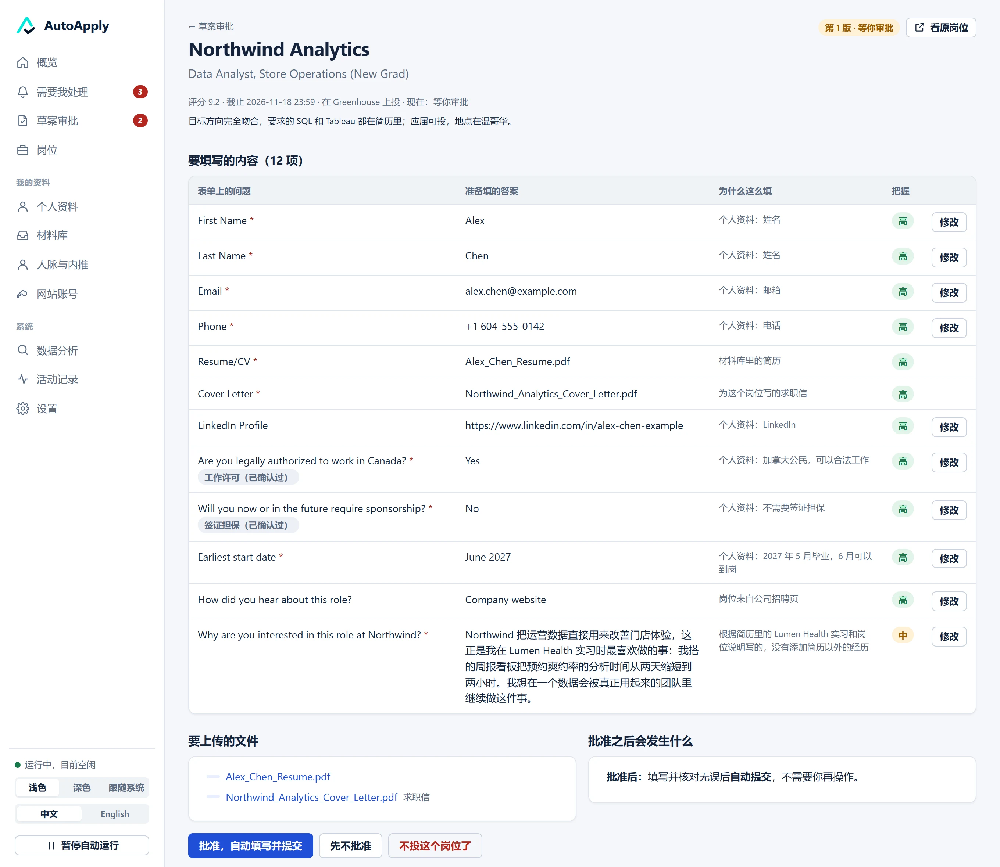
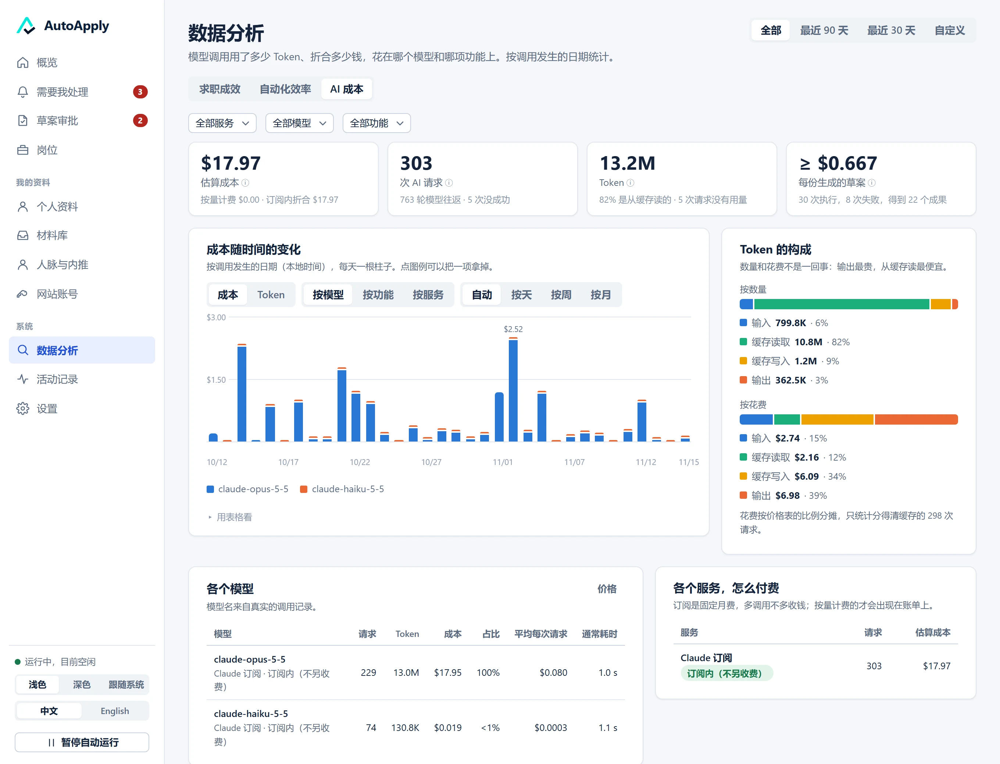
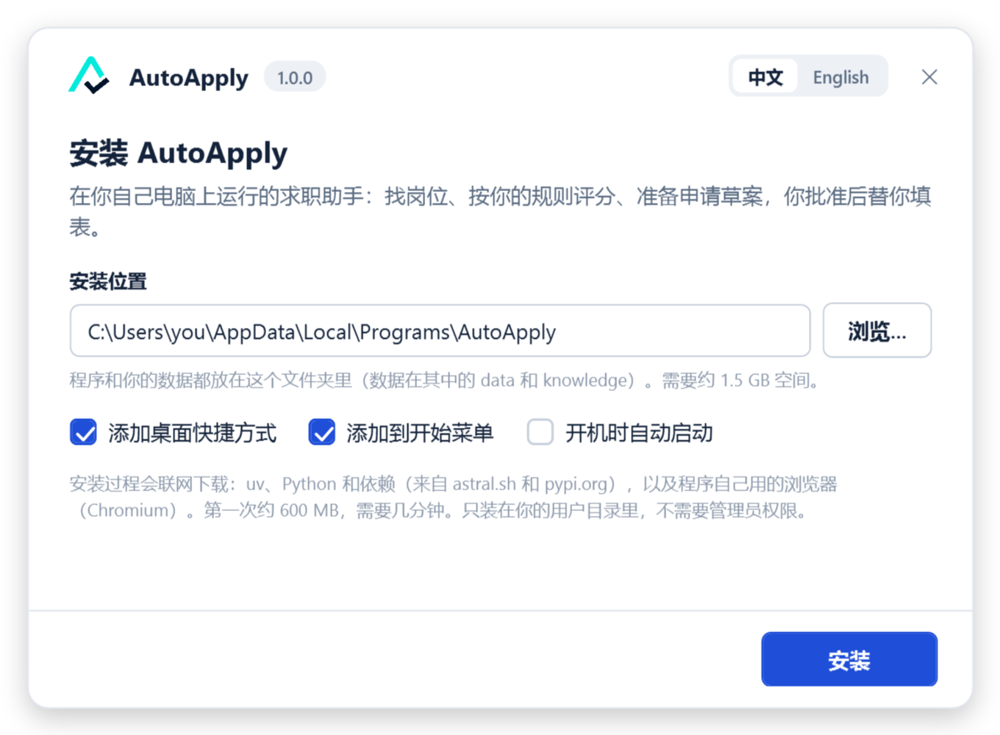
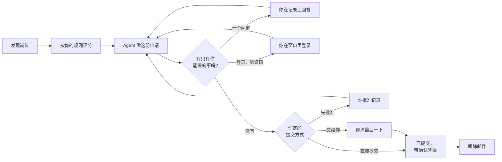

<p align="center">
  
</p>

<p align="center">
  <b>在你自己电脑上运行的求职助手。</b><br>
  找岗位、按你自己的规则评分，然后由一个 AI Agent 把每份申请从岗位页做到确认页，<br>
  只有<b>你</b>才能回答的事它会来问你。之后读邮件，跟踪每份申请的进展。
</p>

<p align="center">
  <a href="https://github.com/Liam-Frost/AutoApply/releases/latest"></a>
  <a href="https://github.com/Liam-Frost/AutoApply/actions/workflows/ci.yml"></a>
  
  <a href="LICENSE"></a>
</p>

<p align="center"><a href="README.md">English</a> | <b>简体中文</b></p>


## 目录

- [它做什么](#它做什么)
- [它不做什么](#它不做什么)
- [安装](#安装)
- [第一次使用](#第一次使用)
- [在服务器上运行](#在服务器上运行)
- [一份申请是怎么投出去的](#一份申请是怎么投出去的)
- [AI 服务、备用和额度](#ai-服务备用和额度)
- [你的数据](#你的数据)
- [前两版错在哪里，这一版改了什么](#前两版错在哪里这一版改了什么)
- [哪些实际验证过](#哪些实际验证过)
- [开发](#开发)
- [社区](#社区)
- [许可](#许可)

## 它做什么

| | |
|---|---|
| **找岗位** | 读你选的雇主的招聘页：Greenhouse、Lever、Ashby、SmartRecruiters、Workday 的公开看板，八家大型科技公司的官网，有订阅源的行业职位站，或者任意招聘页（由 AI 读）。有 46 家雇主和 16 个职位站已经核对过，可以直接勾选。 |
| **评分** | 按你用大白话写的规则评分，规则可以随时改。明显不合适的岗位（国家不对、级别不对）在花 AI 额度之前就被筛掉。 |
| **投递** | 值得投的岗位，由一个 AI Agent 打开雇主的网站，像一个细心的人那样把申请做完：读页面，登录或注册，按你的个人资料和简历填好每一部分，上传对的文件，每做一步都回头看一眼。表单要、而你没告诉过程序的信息，它来问你，不猜。 |
| **留下记录** | 每道题填了什么、依据是什么，都有记录。哪里不对，直接改，或者用平常说话的方式写一句（“写我五月可以到岗”），Agent 会回到网站上改掉。 |
| **按你定的方式提交** | 没有未决问题就自己提交（默认）；或者你批准记录之后再提交；或者做到最后一步停下，把窗口交给你。也可以只对某些公司这样。 |
| **跟踪结果** | 只读你的邮箱，识别确认信、拒信和面试邀请，更新每份申请的状态。 |

它会按你的情况调整：第一次运行时的向导会问你的求职阶段（实习、应届、有经验）、领域和目标岗位，据此设置筛选条件、评分规则和界面。不只是给软件岗位用的。

<table>
<tr>
<td width="50%"><br><sub><b>一份申请的记录。</b>每个答案都带依据。</sub></td>
<td width="50%"><br><sub><b>需要你处理。</b>程序自己做不了的事，逐项列出来。</sub></td>
</tr>
<tr>
<td><br><sub><b>岗位</b>，评分排序，每份申请到了哪一步一目了然。</sub></td>
<td><br><sub><b>备用 AI 服务</b>，以及每家还剩多少额度。</sub></td>
</tr>
<tr>
<td colspan="2"><br><sub><b>AI 花了多少。</b>每次模型请求都有记录：各类 Token、按模型和功能的成本、每个成果的成本、失败花掉的钱。</sub></td>
</tr>
</table>

## 它不做什么

表单怎么填由 Agent 自己判断。有四件事不由它决定：

- **不编造你的任何信息。** 答案、求职信、按岗位改写的简历，只来自你的简历、你的个人资料和你回答过的问题。缺的就问你；有问题没答完的申请不会提交。
- **提交按你定的规则来。** 每次运行都被告知能不能提交；途中保存一步、保存网站要求先填的个人档案，不算提交。只有拿到确认——页面上的原话、网址、以及它和这个岗位的对应关系——才记为“已提交”。如果一次运行说了“要点提交了”之后中断，程序会先去查这份申请有没有发出，再决定要不要碰表单。（这是交给 Agent 的一条指令，它要对此负责；程序并不声称能认出每个网站上的每一个“提交”按钮。）
- **看不到你的密码，也不绕过人机验证。** 保存的密码由程序输入，只输入到这个网站自己的登录页，Agent 只知道“已输入”。验证码、手机上的二次验证、身份核验都交给你。
- **每份申请有预算**（默认 400 步、45 分钟）。用完了 Agent 会停下来，问你要不要继续。

## 安装

从[最新版本](https://github.com/Liam-Frost/AutoApply/releases/latest)下载：

| 系统 | 文件 | 怎么装 |
|---|---|---|
| **Windows 10 / 11** | `AutoApply-Setup-<版本>.exe` | 运行它，选安装位置和要不要快捷方式。 |
| **macOS 12+** | `AutoApply-<版本>-macos.dmg` | 打开后把 AutoApply 拖进“应用程序”。 |
| **Linux** | `AutoApply-<版本>-linux.run` | `sh AutoApply-<版本>-linux.run`（x86-64 和 ARM64；加 `--yes` 可以不提问直接安装，适合服务器） |
| 任意系统，免安装 | `AutoApply-<版本>.zip` | 解压后运行 `start.bat`（Windows）或 `./start.sh`。 |

<p align="center"></p>

安装不需要管理员权限，所有东西都在你的用户目录里。安装程序自带 [uv](https://docs.astral.sh/uv/)，用它下载 Python、依赖和程序自己用的浏览器（约 600 MB，几分钟；可以取消，重新运行会接着来）。运行新版本的安装程序就是升级：不会动你的数据；需要先退出 AutoApply（安装程序会提示并等你）；新版本没能准备好时，会恢复成之前的版本。已经装了同一个版本时再运行一次就是修复。卸载在“设置 → 应用”里，会问你是否连数据一起删除。安装程序的语言跟随系统（中文或英文），也可以在窗口里切换。

> **安装包没有代码签名。** Windows 会提示“Windows 已保护你的电脑”，点“更多信息 → 仍要运行”。macOS 第一次打开时右键点应用，选“打开”。每个安装包都由[发布流程](.github/workflows/release.yml)构建，并在对应系统上实际安装、启动过才会发布；SHA-256 校验值在 `SHA256SUMS.txt` 里。

求职信、按岗位调整简历和 Word 文件预览需要把 Word 转成 PDF：有 Microsoft Word 就用它，没有的话装免费的 [LibreOffice](https://www.libreoffice.org/)。

## 第一次使用

启动后托盘（macOS 是菜单栏）里会出现图标，网页自动打开在 `http://127.0.0.1:8000`。第一次打开时，页面让你设置管理员的用户名和密码；之后每次都要登录，本机访问也一样。忘了密码：托盘菜单里的“重置管理员密码”。

<p align="center"></p>

1. **向导**问你是谁、想找什么，然后给出筛选条件和评分规则的建议，你可以改。
2. **AI 服务**：用 Claude 或 ChatGPT 订阅登录，或者填 API key（见下文）。
3. **个人资料**：上传简历，程序据此起草你的个人资料，并标出申请表会问、但简历上没写的内容。
4. **申请怎么提交**：自己提交、你批准后提交，或者由你来点（“设置 → 自动化与工作计划 → 怎么提交”）。想先看看它怎么做，就选“先给我看”。
5. **试一次**：贴一个岗位的网址，看 Agent 怎么做。

之后它按计划工作：扫描、评分、投递，有事需要你时通知你（在网页里；设置了 Telegram 的话也发到 Telegram）。

## 在服务器上运行

AutoApply 是需要长期运行的智能体，所以可以装在 Linux 服务器、NAS 或任何没有屏幕的电脑上，再从另一台电脑或手机的浏览器里使用。

**用 Docker**（镜像里带了浏览器和它需要的系统库、虚拟屏幕、LibreOffice 和中文字体）：

```bash
curl -O https://raw.githubusercontent.com/Liam-Frost/AutoApply/master/docker-compose.yml
docker compose up -d
docker compose exec autoapply autoapply set-admin     # 设置管理员的用户名和密码
```

然后在那台电脑上打开 `http://127.0.0.1:8000`。所有属于你的东西都在 `autoapply-data` 这个卷里。

**不用 Docker**：`sh AutoApply-<版本>-linux.run --yes --service` 为当前用户安装，并登记成 systemd 用户服务（开机自动启动，出错自动重启）。之后运行 `autoapply doctor --deep`，它会列出这台电脑缺什么（浏览器的系统库、虚拟屏幕、LibreOffice、字体），每一项都给出补上它的命令；“设置 → 系统与数据 → 诊断”里也有同一份清单。

在服务器上有这些不同：

- **需要你操作的窗口在网页里打开。** 登录网站、自己点“提交”、接手一份表单：在桌面电脑上这些会打开一个浏览器窗口。没有屏幕时，这个页面显示在 AutoApply 自己的网页里（页面上方会有提示；设置了 Telegram 的话还会发一条带链接的消息），你在里面点击和输入。拒绝隐藏浏览器的网站会在虚拟屏幕上开一个真实的窗口，同样在网页里显示。
- **从其他设备访问请用 HTTPS。** 服务本身只提供 HTTP。要从这台电脑之外访问，请在前面放一个负责 HTTPS 的反向代理，并在“设置 → 系统与数据 → 远程访问”里打开“由反向代理负责 HTTPS”。在那之前，其他设备打不开远程窗口，因为要在里面输入密码。
- **密码和密钥保存在加密文件里**（`data/secrets.bin`），因为服务器没有系统钥匙串。默认主密钥和它放在一起；想把主密钥放到别处，设置 `AUTOAPPLY_MASTER_KEY_FILE`（Docker secret 或 systemd credential）。主密钥要留一份备份：丢了它，保存的密码就读不出来了。
- **服务器上做不了的登录可以带过去。** 通行密钥（passkey），以及只认它见过的电脑的网站：在自己的电脑上用 AutoApply 登录，在“网站账号”里把登录状态导出（用口令加密），再在服务器上导入。

## 一份申请是怎么投出去的



这条链路值得知道的几点：

- **一个 Agent，整件事。** 它一次拿到全部上下文——岗位说明、你的个人资料和简历、你的文件、这份申请之前的运行做过什么、关于这个网站记下过什么——和一套工具：看页面、列出控件、点击、输入、选择、上传、运行脚本。没有人替它把表单准备好，也没有东西逐次检查它的点击；它做之前看一眼，做之后再看一眼。
- **不能靠模型记性的东西由程序保管。** 申请到了哪一步、它的记录、它的日志、用了多少预算，都在数据库和磁盘上：一次运行被打断——窗口关了、电脑重启了——下一次从这里接着做，必要时换一个新窗口。
- **三种停法，三种处理。** AI 服务的额度用完了：任务等着，额度回来再试。这份申请自己的预算用完了：问你要不要再给一份。连续三次停在同一个地方：连同它记下的话一起交给你。
- **学到的东西是文字。** 做完一个网站，Agent 会把下一次值得知道的事写下来——某个控件怎么用、简历解析会弄错什么——下次先读。关于各个招聘系统（Workday、Greenhouse、Ashby、SmartRecruiters、SuccessFactors 等）的笔记随程序提供。“数据分析 → 网站笔记”里能看到它写了什么，也可以清掉。
- **表单怎么填写在一份你能改的手册里**（“设置 → 系统与数据 → 专家工具 → 提示词”）：可选的部分填不填、职位提醒订不订、隐私声明怎么处理。只和你个人有关的规则，写在个人资料里更合适。

## AI 服务、备用和额度

在“设置 → 账号与连接 → AI 服务”里。

| 服务 | 怎么付费 | 能否查额度 |
|---|---|---|
| Claude 订阅（Pro / Max） | 你的订阅 | 能 |
| ChatGPT 订阅（Plus / Pro） | 你的订阅 | 能 |
| Claude API | 按用量 | 不能（Anthropic 不提供这个接口） |
| OpenAI API | 按用量 | 不能 |
| Google Gemini | 按用量 | 不能 |
| DeepSeek | 按用量 | 能（余额） |
| 通义千问（DashScope） | 按用量 | 不能 |
| OpenRouter | 按用量 | 能（余额） |
| 任何兼容 OpenAI 接口的服务，包括本机的 Ollama | — | 不能 |

**备用服务。** 可以按顺序排一串备用。主用的额度用完、被限流或连不上时，同一步会立刻改用下一个；出问题的那家歇到它的额度重置为止，之后自动切回。主要模型和处理简单任务的小模型都按这条顺序走。

**额度。** 能查的服务会显示已用多少；超过你设的提醒线（默认 80%）时通知你一次；用完的服务在重置之前不再调用。

Claude 订阅是测试得最充分的，Agent 也是用 Anthropic 目前最强的模型做出来、量出来的。其他服务走同一套接口；能力弱的模型做表单更容易出错，而一份完整的申请要调用模型很多次——在真实网站上，一次运行用过几百万缓存 Token。“数据分析 → AI 成本”里能看到每份申请花了多少。

## 你的数据

- 所有东西都在你的电脑上：一个 SQLite 数据库、你的文件，以及几份你能直接读和改的 Markdown 文档（个人资料、评分规则、关于各网站的笔记）。
- 密码和 API key 在系统的密码库里；服务器上没有密码库，改存在一个加密文件里。保存的登录状态是加密的。
- 除了你选的 AI 服务和招聘网站本身，不向任何地方发送数据。没有遥测，不需要注册账号。
- 打开页面要先登录：只有一个账号，用户名和密码由你第一次在运行程序的那台电脑上打开页面时自己设置，程序只保存加盐哈希。
- 服务默认只监听 `127.0.0.1`（可以在“设置 → 系统与数据 → 远程访问”里改），而且只回应它自己的页面：你浏览器里开着的其他网站发来的请求会被拒绝。程序自己不提供 HTTPS，要从自己的网络之外访问，请在前面放一个负责 HTTPS 的反向代理。
- “设置 → 系统与数据 → 备份与更新 → 导出全部数据”会生成一个压缩包；在另一台电脑上用 `uv run autoapply restore <文件.zip>` 恢复。

## 前两版错在哪里，这一版改了什么

一共做了三次，前两次错在同一个方向上。

**第一版**（`legacy-v0` 分支）有大约 5.5 万行代码和 1720 个通过的测试，却投不出一份申请。模型只负责在固定流水线里填几个受限的文本格，看到的是页面的摘要而不是页面，个人信息存成表格和正则表达式。同一段时间里，作者手动驱动一个通用的编程助手，实际投出了 140 多份申请。

**1.0** 让模型看到了页面，却又在它周围搭了一条流水线：先把表单读成结构，再起草答案，由每个招聘系统的专用程序去填，逐项比对，填不下去的页面交给 AI“接手”，用闸门管住它能点什么，从运行里学配方和插件，用保存的页面做自检。它投出过真实的申请。它也长到了大约 3.1 万行代码、86 条正则表达式，模型只在七个很窄的口子里被调用；每遇到一个表现稍有不同的网站，就多一条规则、一道闸门、一个钉在样本页面上的测试：分四个阶段的申请做完第一阶段就报告“填好了”，确认页没有出现预期的字眼就认不出已提交，专用程序坏了只会反复重试，而不是交给本来能把事做完的 Agent。

**2.0** 接受了作者自己手动投递时早就摆在那里的结论：一个有能力的模型，拿到完整的上下文和普通的浏览器工具，就能把申请做完；为了让它“安全”而包在外面的软件，多半只是在妨碍它。

| 1.x 的做法 | 2.0 的做法 |
|---|---|
| 一条分阶段的流水线，每个阶段有自己的窄提示词和工具 | 一个 Agent，一次运行，从岗位页到确认页 |
| 每个招聘系统一个专用程序，其余网站靠探索，再加修复 Agent 和闸门 | 所有网站用同一套浏览器工具；对某个系统的了解是 Agent 读的笔记 |
| 先把表单读成结构，对着结构起草答案，事后再比对 | Agent 直接填真实的表单，然后交代它填了什么、为什么 |
| 用代码规定什么是按钮、确认页长什么样、哪一步是最后一步 | 页面由 Agent 判断；程序只守四条限制，保管状态 |
| 学到的东西存成配方、插件和保存的页面，再用更多代码去检查 | 学到的东西存成句子 |
| 测试钉在真实网站的页面样本上 | 评测用的表单带“雇主一侧”：一次运行按雇主实际收到了什么来评判（`eval/`） |

专用程序、兜底链路、修复 Agent、闸门、学到的插件和自检都删掉了，没有留作回退：一共 1.5 万多行代码和测试。

## 哪些实际验证过

如实的状态记在 [docs/STATUS.md](docs/STATUS.md)。简要地说：

| | 状态 |
|---|---|
| Windows 10 / 11 | 每天在用 |
| 申请 Agent 在项目自带的评测表单上（先建档案的分步表单、嵌在另一个网站框架里的表单、要注册账号的网站；一次中途被杀掉再接着做的运行） | 每一项检查都通过，按“雇主一侧”实际收到的内容评判 |
| 申请 Agent 在真实网站上 | 三个真实岗位做到了最后一步、没有提交（一个 SAP SuccessFactors 网站、一个 Workday 网站、Google Careers）：需要的账号建好了，每一步都填了，该问的问了。**2.0 的 Agent 还没有真正提交过一份申请** |
| 自己提交、批准后提交、把窗口交给你 | 在评测表单上经任务队列跑通；没有在真实网站上跑过 |
| 用 1.x 投出去的申请（Greenhouse、Microsoft Careers、BambooHR 和 JazzHR 的网站） | 真实投递过并收到确认邮件；那部分代码已经删除 |
| 由 Agent 读取学校门户 | 在评测站点的假门户上跑通（要登录、列表分两页）：登录、列全、每个岗位都存了下来。没有在真实门户上跑过 |
| UBC 门户 | 实际导入过岗位；由 Agent 扫描门户、在门户里投递，都还没有在真实门户上确认 |
| 登录、监听地址和路径前缀 | 登录在一份空白副本上从头到尾跑过；从另一台设备访问、放在真实的反向代理后面都没有跑过 |
| Windows 安装程序（安装、升级、程序运行中时拒绝安装、取消并恢复旧版本、卸载） | 在临时文件夹里从头到尾实跑过，每次发布由 CI 再跑一遍 |
| AI 服务之间的故障转移 | 在一家订阅的额度真的用完时实跑过一次 |
| macOS 和 Linux 安装包 | 每次发布都由 CI 构建、安装并启动；作者日常不用这两个系统 |
| Claude 订阅以外的 AI 服务 | 接口测过；投递质量没有比较过 |
| 英文界面 | 机器翻译，没有人工校对 |

## 开发

```bash
git clone https://github.com/Liam-Frost/AutoApply
cd AutoApply
./start.sh            # 或 start.bat：缺什么装什么，构建界面，然后启动
```

| 命令 | 作用 |
|---|---|
| `uv run pytest` | 测试（不会访问真实的 AI 服务或真实网站） |
| `uv run autoapply serve` | 只启动服务，在终端里运行 |
| `uv run autoapply tray` | 托盘启动器 |
| `uv run autoapply reset-admin` | 忘掉管理员密码；下次在本机打开页面时重新设置 |
| `uv sync --extra nodriver` | 安装可选的备用浏览器后端 |
| `cd frontend && npm run dev` | 界面的开发模式 |
| `uv run python scripts/demo.py --serve 8020` | 一份全是虚构数据的演示实例（截图用的就是它） |
| `uv run python scripts/make_release.py` | 打免安装的 zip |
| `uv run python scripts/make_installer.py` | 打 Windows 安装包 |

目录：`backend/autoapply`（FastAPI、SQLite、Playwright；`agent/` 是申请 Agent——`apply.md` 是它的手册，`hands.py` 是浏览器工具，`run.py` 是一次运行，`work.py` 把一次运行的结果落到程序里，`playbooks/` 是各招聘系统的笔记；`llm.py` 是各家 AI 服务和故障转移，`access.py` 是登录和监听地址）、`eval`（带“雇主一侧”的评测表单和跑评测的脚本：`python eval/run.py --all`，或用 `--form profile_first` 只跑一种形态，会用掉你的 AI 额度）、`frontend`（Vue 3）、`scripts`（打包、安装、演示）、`docs`。

**发布。** 改 `pyproject.toml` 里的版本号，在 `CHANGELOG.md` 里加上这一版的说明，然后：

```bash
git tag v1.2.3 && git push origin v1.2.3
```

发布流程会跑测试、构建四个安装包，在 Windows、macOS、Linux 上各自安装并启动一遍，都通过了才发布。

只往某个清单里加一项的贡献（一家雇主、一个职位站、一种第三方登录、一种邮箱、一个地区包、一种翻译）不需要了解整个程序，见 [CONTRIBUTING.md](CONTRIBUTING.md)。界面遵循 [docs/DESIGN_SYSTEM.md](docs/DESIGN_SYSTEM.md)。

## 社区

- 遇到问题或有想法：[提一个 issue](https://github.com/Liam-Frost/AutoApply/issues/new/choose)。
- 安全问题：请私下报告，方法见 [SECURITY.md](SECURITY.md)。
- 怎么参与：[CONTRIBUTING.md](CONTRIBUTING.md) 和[行为准则](CODE_OF_CONDUCT.md)。
- 每个版本改了什么：[CHANGELOG.md](CHANGELOG.md)。

## 许可

[PolyForm Noncommercial 1.0.0](LICENSE)：个人使用和其他非商业用途免费。

各招聘网站的使用条款由你自己负责遵守。这个程序是用你自己的信息填写你自己的申请；它不是替别人投递或批量投递的工具。
